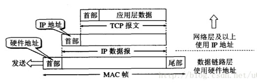
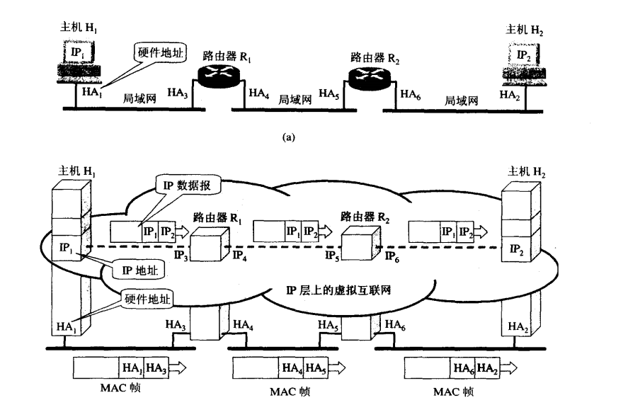
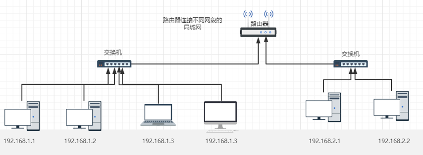

# Lab 3 网络接口与 IP 路由器

!!! warning "注意"
    实验报告提交 DDL 为 2026 年 10 月 25 日 23:59，请同学们留意。

    提交作业时请同时提交实验报告和源代码（可以只提交已修改的部分）。

## 1 引言

在上一次实验中，我们熟悉了 socket 提供的部分接口，例如 `connect()`、`write()` 和 `read()`，并实现了一个简化的 socket 读写缓冲区（ByteStream）。为了与课程进度保持一致，我们暂时将 TCP Receiver、TCP Sender 和 TCP Connection 安排在后续两次实验中。本次实验将聚焦于**网络层与链路层的交互**，并实现以下两个组件：

- 网络接口（Network Interface）：解析下一跳 IP 地址对应的以太网地址，即实现地址解析协议（ARP）。
- 简易路由器（Router）：根据给定的数据报确定下一跳 IP 地址和发送接口。

## 2 网络接口

本章将实现网络接口类，使其能够收发数据报。实现前，需要先了解 MAC 地址及其作用。

### 2.1 IP 地址与 MAC 地址

IP 地址是网络层使用的逻辑地址；MAC 地址（以太网地址）是数据链路层用于标识网络接口的地址。MAC 地址通常由网卡制造商分配，但也可以由软件配置。如下图所示，源主机发送数据时，数据会从高层到低层依次封装。IP 数据报交给数据链路层后，会被封装成以太网帧，再通过通信链路传输。



如下图所示，以太网帧在本地链路上传输时，其首部记录的是源 MAC 地址和目的 MAC 地址；作为帧负载的 IP 数据报则保留端到端的源 IP 地址和目的 IP 地址。如果数据报的最终目的主机与发送方位于同一局域网，帧的目的 MAC 地址就是该主机的 MAC 地址；如果最终目的主机位于其他网络，帧的目的 MAC 地址则是下一跳路由器的 MAC 地址。因此，网络接口发送数据报前需要获得下一跳 IP 地址对应的 MAC 地址。



### 2.2 地址解析协议（ARP）

那么，网络接口如何找到下一跳 IP 地址对应的 MAC 地址呢？这就需要用到 **地址解析协议**（Address Resolution Protocol，ARP）。地址解析是指网络接口在发送以太网帧前，查询本地链路中某个 IP 地址对应的 MAC 地址，如下图所示。


每个网络接口都会维护一个 ARP 缓存表，记录当前已知的 IP 地址到 MAC 地址的映射，如下表。当主机 A 需要发送 IP 数据报时，会先根据路由结果确定下一跳 IP 地址，再在 ARP 缓存表中查找相应的 MAC 地址。如果找到，就将该地址写入以太网帧首部并发送；如果没有找到，则在本地链路上广播 ARP 请求。拥有目标 IP 地址的主机或路由器收到请求后，会单播发送 ARP 应答。发送方收到应答后，将映射写入 ARP 缓存表。为了避免使用陈旧映射并节省空间，每个缓存表项只保留 30 秒，超时后应将其删除。

| 主机名称 | IP 地址       | MAC 地址          |
| -------- | ------------- | ----------------- |
| A        | 192.168.38.10 | 00-AA-00-62-D2-02 |
| B        | 192.168.38.11 | 00-BB-00-62-C2-02 |
| C        | 192.168.38.12 | 00-CC-00-62-C2-02 |
| D        | 192.168.38.13 | 00-DD-00-62-C2-02 |
| E        | 192.168.38.14 | 00-EE-00-62-C2-02 |
| ...      | ...           | ...               |

### 2.3 实现网络接口类

在实现之前，你需要：

- 阅读 `libsponge/tcp_helpers/ethernet_frame.hh` 和 `libsponge/tcp_helpers/ethernet_header.hh`，了解如何组装以太网帧。

```c++
EthernetFrame frame;
frame.header().src = ?;
frame.header().dst = ?;
frame.header().type = ?;
frame.payload() = ?;
```

- 阅读 `libsponge/tcp_helpers/ipv4_datagram.hh` 和 `libsponge/tcp_helpers/ipv4_header.hh`，了解如何将数据报序列化为以太网帧的负载，以及如何反序列化该负载以读取数据报。

- 阅读 `libsponge/tcp_helpers/arp_message.hh`，了解如何组装 `ARPMessage` 对象，以及如何对其进行序列化和解析。

```c++
ARPMessage arp_request;
arp_request.opcode = ?;
arp_request.sender_ethernet_address = ?;
arp_request.sender_ip_address = ?;
arp_request.target_ethernet_address = ?;
arp_request.target_ip_address = ?;
```

你需要实现 `libsponge/network_interface.hh` 和 `libsponge/network_interface.cc`。实现后的网络接口需要满足以下要求：

- 发送数据报：查询 ARP 缓存表并组装以太网帧。如果缓存表中没有下一跳的映射，则缓存待发送的数据报并广播 ARP 请求。对于同一个尚未解析的 IP 地址，如果最近 5 秒内已经发送过 ARP 请求，则只缓存数据报，不重复发送请求；超过 5 秒后，后续发送数据报时可以再次触发 ARP 查询。
- 接收以太网帧：如果帧中包含 IPv4 数据报，则将其传递给网络层；如果帧中包含有效的 ARP 消息，则记录请求或应答中发送方的 IP 地址与 MAC 地址。仅当 ARP 请求询问本接口的 IP 地址时才发送应答；获得映射后，发送等待该映射的缓存数据报。
- 维护 ARP 缓存表：每个表项保留 30 秒，超时后将其删除。

具体来说，你需要在 `.hh` 文件中添加必要的成员变量，并在 `.cc` 文件中实现以下三个方法：

```c++
void NetworkInterface::send_datagram(const InternetDatagram &dgram, const Address &next_hop);
// 如果 ARP 缓存表中已有下一跳的以太网地址，则创建一个类型为 EthernetHeader::TYPE_IPv4 的以太网帧，以序列化后的数据报为负载，设置源和目的以太网地址后立即发送。
// 如果下一跳的以太网地址未知，则缓存数据报。若最近 5 秒内没有为同一个下一跳 IP 地址发送过 ARP 请求，则广播一个 ARP 请求；否则只需等待已有请求的应答。

optional<InternetDatagram> NetworkInterface::recv_frame(const EthernetFrame &frame);
// 首先，检查目标 MAC 地址。如果它既不是本接口的地址，也不是广播地址，则直接丢弃该帧。
// 如果以太网帧的类型为 IPv4，则调用 parse() 将有效负载解析为 InternetDatagram。若解析成功，即 parse() 返回 ParseResult::NoError，则将结果返回给调用者。
// 如果入站帧的类型为 ARP，则将负载解析为 ARPMessage。解析成功后，记录发送者的 IP 地址到以太网地址的映射并保留 30 秒，随后发送等待该映射的缓存数据报。
// 如果收到的是针对本接口 IP 地址的 ARP 请求，则发送适当的 ARP 应答。

void NetworkInterface::tick(const size_t ms_since_last_tick);
// 删除 ARP 缓存表中已过期的映射，并根据 ms_since_last_tick 更新其余表项的剩余有效时间。
// ARP 请求记录保留 5 秒。删除已过期的记录，使后续的 send_datagram 调用可以再次发送请求，并根据 ms_since_last_tick 更新其余记录的剩余有效时间。
```

完成实现并重新编译后，在 `build/` 目录中运行 `ctest -V -R "^arp"` 进行测试。实现正确时，将看到类似以下输出：

```
$ ctest -V -R "^arp"
UpdateCTestConfiguration  from :/path/to/zju-comnet-labs-2026/build/DartConfiguration.tcl
UpdateCTestConfiguration  from :/path/to/zju-comnet-labs-2026/build/DartConfiguration.tcl
Test project /path/to/zju-comnet-labs-2026/build
Constructing a list of tests
Done constructing a list of tests
Updating test list for fixtures
Added 0 tests to meet fixture requirements
Checking test dependency graph...
Checking test dependency graph end
test 32
    Start 32: arp_network_interface

32: Test command: /path/to/zju-comnet-labs-2026/build/tests/net_interface
32: Working Directory: /path/to/zju-comnet-labs-2026/build
32: Test timeout computed to be: 10000000
32: DEBUG: Network interface has Ethernet address ea:29:0b:b1:3e:ea and IP address 4.3.2.1
32: DEBUG: Network interface has Ethernet address b2:41:4b:b9:a7:80 and IP address 5.5.5.5
32: DEBUG: Network interface has Ethernet address d6:f4:18:dd:0e:cd and IP address 5.5.5.5
32: DEBUG: Network interface has Ethernet address 1a:14:0c:94:ed:0b and IP address 1.2.3.4
32: DEBUG: Network interface has Ethernet address c2:13:57:87:a7:91 and IP address 4.3.2.1
32: DEBUG: Network interface has Ethernet address da:03:ee:67:f0:25 and IP address 10.0.0.1
1/1 Test #32: arp_network_interface ............   Passed    0.01 sec

The following tests passed:
        arp_network_interface

100% tests passed, 0 tests failed out of 1

Total Test time (real) =   0.01 sec
```

## 3 简易路由器

上一章实现了网络接口，本章将在此基础上实现简易路由器。

### 3.1 路由器

路由器用于连接两个或多个不同的网络。它通常包含多个网络接口，每个接口都连接到一个局域网，并具有属于该局域网网段的 IP 地址。局域网内的主机需要访问其他网络时，会将路由器作为网关。

路由器从任一接口收到 IP 数据报后，会根据目的 IP 地址查询路由表，选择合适的下一跳和输出接口进行转发。目的 IP 地址不属于路由器自身并不是丢弃数据报的理由；只有在 TTL 不足、没有匹配路由等情况下，路由器才会丢弃数据报。



### 3.2 路由表

路由表是路由器用来确定数据报转发路径的数据结构。它记录不同目的网络与对应转发路径之间的映射关系。每一行代表一个路由条目，通常包含以下字段：

| 字段名称         | 含义                                                               |
| ---------------- | ------------------------------------------------------------------ |
| **目的网络前缀** | 需要匹配的网络前缀 `route_prefix`，例如 `192.168.1.0`              |
| **前缀长度**     | 需要匹配的高位比特数 `prefix_length`，例如 `/24`                   |
| **下一跳**       | 下一跳的 IP 地址 `next_hop`；为空时表示直连，并将数据报的目的 IP 地址作为下一跳 |
| **接口号**       | 数据报通过哪个网络接口发出，对应 `interface_num`                   |

当一个 IP 数据报到达路由器时：

1. 路由器检查数据报的**目的 IP 地址**。
2. 与路由表中的所有条目进行**匹配**。
3. 按照**最长前缀匹配（Longest Prefix Match）**原则选择最具体的路由。
4. 根据匹配到的条目，将数据报从对应的接口转发到合适的下一跳。

> 例如，若目的地址为 `192.168.1.25`，且路由表包含：
>
> - `192.168.1.0/24` → eth0
> - `192.168.0.0/16` → eth1
>
> 路由器将选择前缀更长的 `/24` 路由。

!!! note "提示"
    如需在 32 位整数与 `Address` 对象之间转换，可以使用 `Address::from_ipv4_numeric()` 和 `Address::ipv4_numeric()`。

### 3.3 实现路由类

你需要实现 `libsponge/router.hh` 和 `libsponge/router.cc`。具体来说，需要在 `.hh` 文件中添加必要的成员变量，并在 `.cc` 文件中实现以下两个方法：

```c++
void Router::add_route(const uint32_t route_prefix,
                       const uint8_t prefix_length,
                       const optional<Address> next_hop,
                       const size_t interface_num);
// 此方法用于添加路由条目。请在 Router 类中添加保存路由表的私有成员，并在此方法中存储 route_prefix、prefix_length、next_hop 和 interface_num。

void Router::route_one_datagram(InternetDatagram &dgram);
// 此方法需要根据“最长前缀匹配”规则，选择适当的输出接口和下一跳来转发数据报。
// 如果数据报的 ttl 小于或等于 1，则直接丢弃；否则将 ttl 减 1。数据报后续序列化时会重新计算 IPv4 首部校验和。
// 对于一条路由，如果目的 IP 地址与 route_prefix 的高 prefix_length 位相同，则该路由匹配。在所有匹配项中选择 prefix_length 最大的路由；如果没有匹配项，则丢弃数据报。
// 如果所选路由的 next_hop 有值，则将其作为下一跳；如果 next_hop 为空，则将数据报的目的 IP 地址作为下一跳。最后，通过 interface_num 指定的接口发送数据报。
```

完成实现并重新编译后，在 `build/` 目录中运行 `make check_lab1` 进行测试。实现正确时，将看到类似以下输出：

```
$ make check_lab1
Testing Lab 1...
Test project /home/cs144/project/zju-comnet-labs-2026/build
    Start 32: arp_network_interface
1/2 Test #32: arp_network_interface ............   Passed    0.00 sec
    Start 33: router_test
2/2 Test #33: router_test ......................   Passed    0.01 sec

100% tests passed, 0 tests failed out of 2

Total Test time (real) =   0.01 sec
Built target check_lab1
```
