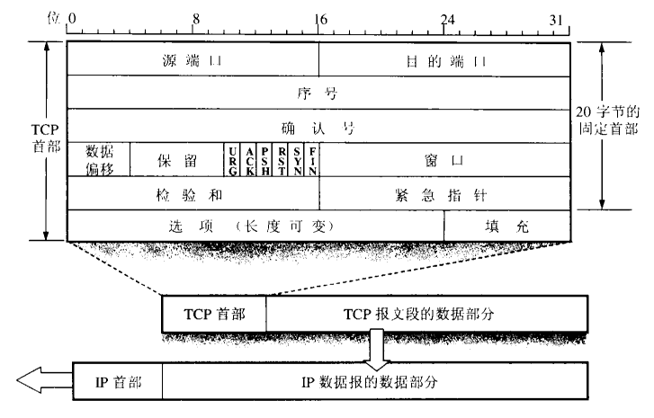
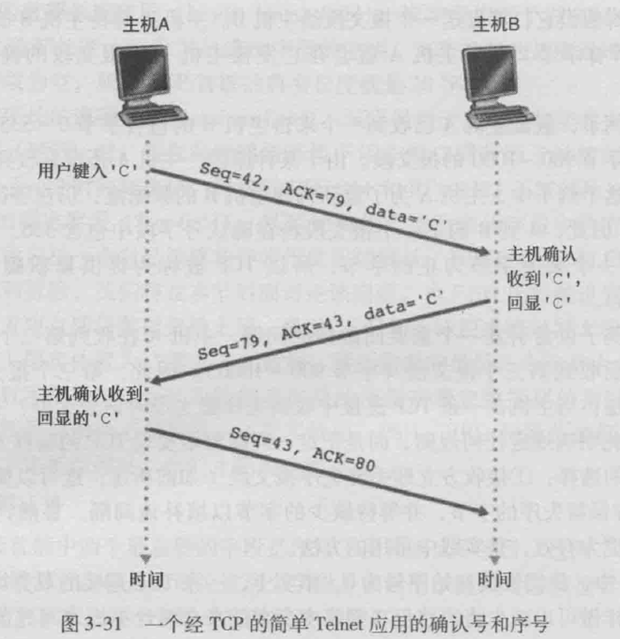
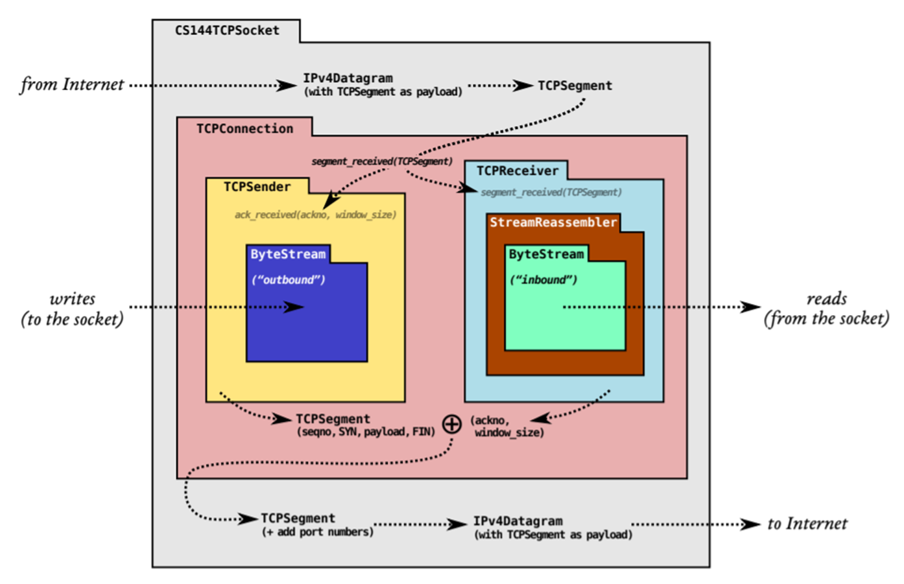
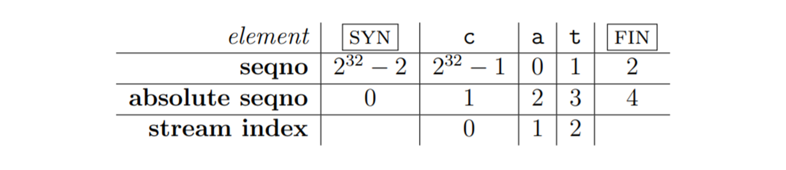

# Lab 4 TCP 接收方（Receiver）与发送方（Sender）

!!! warning "注意"
    实验报告提交截止时间为 2026 年 11 月 15 日 23:59，请同学们留意。

    提交作业时请同时提交实验报告和源代码（可以只提交已修改的部分）。

## 1 引言

在上一次实验中，我们学习了网络层和数据链路层的基本内容，实现了 ARP 和简易路由器，可以完成 IP 数据报的转发。本次实验将聚焦于**传输层**，理解 TCP 的基本机制，并实现 TCP 接收方与发送方，正确处理序列号、乱序数据、确认和重传。

## 2 TCP 协议简介

TCP（Transmission Control Protocol，传输控制协议）是传输层协议，通常承载于 IP 之上，为应用程序提供可靠、有序、面向字节流的通信服务。

IP 负责在网络之间传输数据报，但不保证数据一定到达、按序到达或只到达一次。TCP 通过确认、重传和流量控制等机制，为应用层提供可靠、有序的字节流。

### 2.1 TCP 的可靠传输机制
为了在不可靠的 IP 网络层之上实现可靠传输，TCP 通常使用以下机制：

- **差错检测**：通过校验和等机制检测传输中的错误（本实验不要求重新实现 TCP 校验和）
- **接收方反馈**：接收方通过确认号和窗口大小反馈已按序接收的数据以及当前可接收的数据量。
- **重传**：重传计时器超时后，发送方重传尚未确认的报文段。

而在本次实验中，我们主要需要实现后两种机制。

### 2.2 TCP 首部
每个 TCP 报文段都包含一个 TCP 首部，用于存储报文段的元信息。首部结构如下：


我们主要介绍本次实验涉及到的部分：

- **序列号（Sequence Number）**：表示该报文段序列空间的起始位置。若置位 SYN，SYN 占用该位置，payload 从下一个序列号开始；SYN 和 FIN 各占用一个序列号空间。每个传输方向都有一个初始序列号（ISN）。
- **确认号（Acknowledgment Number）**：表示接收方累计确认后，期望收到的下一个序列号。
- **SYN**：置 1 表示该报文段用于同步初始序列号，并占用一个序列号空间。
- **FIN**：置 1 表示发送方结束字节流，并占用一个序列号空间。
- **窗口（Window Size）**：用于流量控制，表示接收方从当前确认号开始可接收的序列空间长度。

### 2.3 TCP 传输示例



1. 主机 A 发送序列号为 42、携带字符 `C` 的 TCP 报文段，并设置 ACK=79，表示 A 期望收到 B 的下一个序列号为 79。
2. 主机 B 收到 `C` 后，确认号变为 `42 + 1 = 43`。B 随后发送序列号为 79、确认号为 43、携带字符 `C` 的报文段。
3. 主机 A 收到 B 的 `C` 后，确认号变为 `79 + 1 = 80`，再发送 ACK=80 的报文段；图中该报文段的序列号为 43。


!!! note "说明"
    - 如果主机 A 没有收到 ACK=43，可能是 A 发出的数据段丢失，也可能是 B 发出的确认段丢失。发送方会在重传计时器超时后重传尚未确认的最早报文段；计时器时长称为重传超时时间（RTO）。
    - 如果 RTO 短于实际往返时间，发送方可能在确认到达前触发重传。实际 TCP 会估算往返时间；本实验按给定的初始 RTO 和超时退避规则实现。

### 2.4 CS144 TCP 模块整体结构



图中，TCPConnection 协调 TCPSender 和 TCPReceiver。TCP 报文段封装在 IP 数据报中；TCPConnection 将收到的报文段交给接收方处理，并把确认号和窗口信息交给发送方。发送方生成的 TCP 报文段再由 TCPConnection 交给网络层发送。本次实验只实现 Receiver 和 Sender，不实现 TCPConnection 的连接状态机。

## 3 你的任务
### 3.1 流重组器和索引处理
应用数据较长时，TCP 会将字节流拆分为多个报文段传输。报文段在网络中可能丢失、乱序到达或重复到达，因此需要一个**流重组器**将数据片段重新整合为顺序正确、连续且无重复的字节流。

因此，你需要先阅读 `libsponge/stream_reassembler.cc` 和 `libsponge/stream_reassembler.hh`，了解流重组器的功能及实现原理。

流重组器使用 64 位流索引表示应用数据字节的位置，而 TCP 首部使用 32 位循环序列号。接收方需要根据 ISN 和参考绝对序列号（checkpoint），将循环序列号还原为最接近 checkpoint 的 64 位绝对序列号，再根据报文段是否包含 SYN，计算 payload 的流索引。

!!! note "说明"
    本次实验涉及三种索引：

    - 序列号（seqno）：相对于 ISN 的 32 位循环序列号，SYN、数据字节和 FIN 都占用序列号空间。
    - 绝对序列号（absolute seqno）：从 0 开始的 64 位非循环序列号，包含 SYN、数据字节和 FIN。
    - 流索引（stream index）：从 0 开始的 64 位非循环索引，只表示应用数据字节，不包含 SYN 和 FIN。

    

你需要实现 `libsponge/wrapping_integers.hh` 和 `libsponge/wrapping_integers.cc` 中的两个方法：

```cpp
WrappingInt32 wrap(uint64_t n, WrappingInt32 isn);
// 根据绝对序列号 n 和初始序列号 isn，计算对应的 32 位循环序列号

uint64_t unwrap(WrappingInt32 n, WrappingInt32 isn, uint64_t checkpoint);
// 根据 32 位循环序列号 n、初始序列号 isn 和参考绝对序列号 checkpoint，
// 计算最接近 checkpoint 的绝对序列号
```

编译项目后，在 `build/` 目录中运行 `ctest -R wrap` 进行测试。测试通过时，输出应类似于：

```
Test project /home/cs144/zju-comnet-labs-2026/build
    Start 1: t_wrapping_ints_cmp
1/4 Test #1: t_wrapping_ints_cmp ..............   Passed    0.00 sec
    Start 2: t_wrapping_ints_unwrap
2/4 Test #2: t_wrapping_ints_unwrap ...........   Passed    0.00 sec
    Start 3: t_wrapping_ints_wrap
3/4 Test #3: t_wrapping_ints_wrap .............   Passed    0.00 sec
    Start 4: t_wrapping_ints_roundtrip
4/4 Test #4: t_wrapping_ints_roundtrip ........   Passed    0.08 sec

100% tests passed, 0 tests failed out of 4

Total Test time (real) =   0.11 sec
```

### 3.2 TCP Receiver & Sender
你需要实现接收方和发送方两个部分。

对于 `receiver` 来说，你需要实现 `libsponge/tcp_receiver.cc` 和 `libsponge/tcp_receiver.hh` 两个文件，实现以下功能：

- 接收 TCP 报文段，并将其中的数据重新组装为字节流；
- 计算需要返回给发送方的确认号（ACK）和接收窗口大小。

!!! warning "注意"
    完整 TCP 连接通常通过握手建立，并通过 FIN/ACK 关闭。本实验只实现 TCP 接收方和发送方，不实现连接状态机：收到 SYN 后开始处理该方向的数据流；收到并按序处理 FIN 后，表示发送方结束了这一方向的字节流。TCP 连接的另一方向仍可继续传输。

具体而言，你需要实现以下三个方法：
```cpp
void TCPReceiver::segment_received(const TCPSegment &seg);
// 尚未收到 SYN 时，丢弃不带 SYN 的报文段；首次收到 SYN 时记录 ISN，之后不覆盖。
// 以 1 + stream_out().bytes_written() 作为 unwrap 的 checkpoint，
// 调用 unwrap(seg.header().seqno, isn, checkpoint) 得到 absolute_seqno。
// payload 的 stream_index = absolute_seqno（本段含 SYN），
// 否则为 absolute_seqno - 1。
// 调用 _reassembler.push_substring(seg.payload().copy(), stream_index, seg.header().fin)。
//
// 注意：收到 SYN 的同一报文段也可能携带 payload 和/或 FIN，均须处理。

std::optional<WrappingInt32> TCPReceiver::ackno() const;
// 尚未收到 SYN 时返回空。否则计算：
// absolute_ackno = 1（SYN） + stream_out().bytes_written()
// 如果 FIN 已按序到达且 stream_out().input_ended()，再加 1（FIN）。
// 最后用 wrap(absolute_ackno, isn) 转换为 32 位确认号。

size_t TCPReceiver::window_size() const;
// 返回 _capacity - _reassembler.stream_out().buffer_size()，
// 即接收方当前可通告的窗口大小。

```

对于 `sender`，你需要实现 `libsponge/tcp_sender.cc` 和 `libsponge/tcp_sender.hh`。除以下四个发送事件方法外，还要实现 `bytes_in_flight()` 和 `consecutive_retransmissions()` 两个访问器，并在头文件中添加跟踪未确认报文段、远端窗口、重传计时器及 SYN/FIN 状态所需的成员变量。
```cpp
void fill_window();
// 尚未收到窗口通告时，远端窗口按 1 处理。
// 尽可能填满发送窗口。可用空间 = max(有效远端窗口 - bytes_in_flight(), 0)；
// 每段 payload 不得超过 TCPConfig::MAX_PAYLOAD_SIZE（1000 字节）。
// 报文段占用的序列号空间还包括 SYN 和 FIN（各占 1）。
// 若远端通告窗口为 0，按本实验要求将有效窗口暂时视为 1。
// 这条规则只用于填充窗口时的计算，不要把远端通告窗口永久改成 1。
// 有待发送数据时，可发送一个探测字节，以促使接收方反馈更新后的窗口。

// 具体思路：
// 1. 尚未发送 SYN 时，将 SYN 置 1。
// 2. 按当前可用窗口和最大 payload 长度读取输入字节流，并设置 seqno 和 payload。
// 3. 取出 payload 后，若 stream_in().eof() 为 true、FIN 尚未发送，
//    且窗口仍有至少 1 个序列号位置，则设置 FIN。
//    eof() 表示输入已结束且待发送数据已全部取出。
// 4. 若报文段没有 SYN、FIN 或 payload，则停止发送。
// 5. 若本次发送前没有未确认数据，则启动重传计时器；若计时器已运行，不重启。
// 6. 将占用序列号空间的报文段保存到未确认队列，并放入 segments_out()；
//    更新 next_seqno。零长度 ACK 不加入未确认队列。
// 7. FIN 发送后停止继续填充窗口。

size_t bytes_in_flight() const;
// 返回尚未被 ACK 确认的序列号空间长度；SYN 和 FIN 各计 1。

size_t consecutive_retransmissions() const;
// 返回当前连续重传次数。

void tick(const size_t ms_since_last_tick);
// tick 使用传入的时间增量推进重传计时器，不调用系统时钟。
// 若计时器超时且有未确认数据，重传序列号最小的未确认报文段，并重启计时器。
// 若当前通告窗口非零，则将连续重传次数加 1 并将 RTO 加倍；窗口为零时两者均不变。


void ack_received(const WrappingInt32 ackno, const uint16_t window_size);
// 使用 unwrap(ackno, isn, next_seqno_absolute()) 还原 ACK；
// 若其大于 next_seqno_absolute()，忽略该 ACK 并返回。
// 移除已被完整确认的报文段，并更新有效 ACK 携带的远端窗口。
// 只有 ACK 前进并确认了新的序列号空间时，才清零连续重传次数并恢复初始 RTO；
// 若仍有未确认数据，则重启计时器，否则停止计时器。最后调用 fill_window()。


void send_empty_segment();
// 生成一个 payload 长度为零、SYN 和 FIN 均未设置的 TCPSegment，
// seqno 设为当前 next_seqno 后放入 segments_out()；该段不占序列号空间，
// 也不加入未确认队列。
```

完成实现并编译后，在 `build/` 目录下运行 `make check_lab2`。该目标会测试 wrapping integers、stream reassembler、TCPReceiver 和 TCPSender。测试通过时，输出应类似如下内容（测试耗时和测试编号可能不同）：

```
Test project /home/cs144/zju-comnet-labs-2026/build
      Start  1: t_wrapping_ints_cmp
 1/34 Test  #1: t_wrapping_ints_cmp ..............   Passed    0.00 sec
 ...
 33/34 Test #54: t_parser_dt ......................   Passed    0.00 sec
      Start 55: t_socket_dt
34/34 Test #55: t_socket_dt ......................   Passed    0.01 sec

100% tests passed, 0 tests failed out of 34

Total Test time (real) =   2.33 sec
[100%] Built target check_lab2
```

