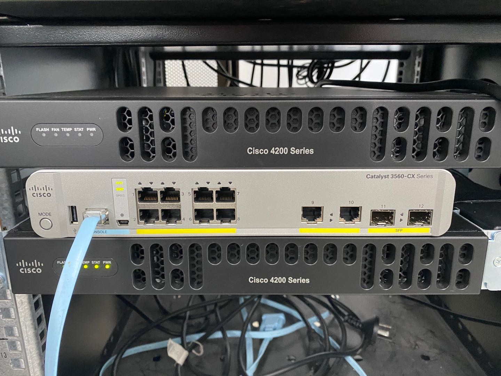
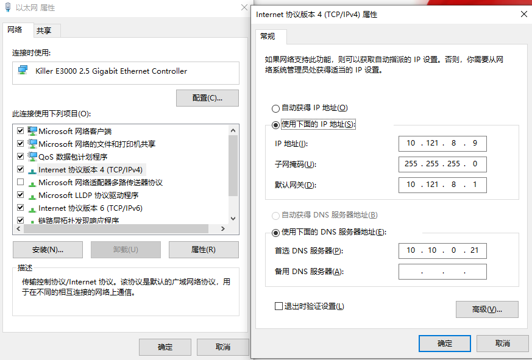
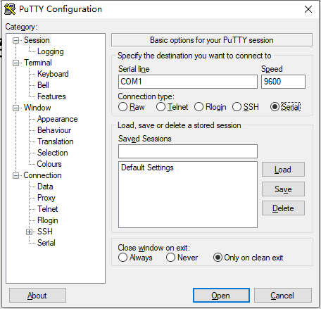
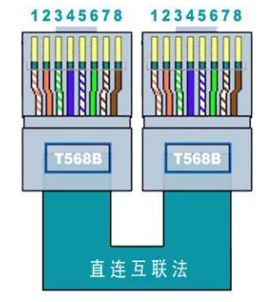
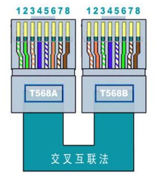

# 选做实验：使用二层交换机组网
!!! warning "注意"
    本实验为选做内容，不计入课程成绩(无附加分)，同学们可以根据自身情况自行探索。

    实验模板及工具网站：http://10.214.0.253/network/download/（本实验的实验模板对应网站上Lab2）

!!! warning "安全要求"
    本选做实验的实验地点为曹西二楼的网安实验室。

    带环路的冗余链路、关闭端口和 Telnet 管理只在隔离的实验拓扑中操作。不得在校园网、宿舍网、办公网或其他共享网络中关闭 STP、接入环路或修改他人设备。开始前记录并备份实验端口的原有配置；只修改本实验使用的端口。

## 1 实验目标

- 观察交换机学习源 MAC 地址并转发以太网帧的过程。
- 配置 Access 端口和 VLAN，验证 VLAN 对广播域的隔离作用。
- 配置 Trunk，使同一 VLAN 的主机能够跨交换机通信。
- 使用 SPAN 端口镜像观察其他交换机端口上的流量。
- 保持 STP 启用，观察冗余链路上的转发/阻塞状态及链路故障后的恢复。

本实验重点是二层交换机的端口、VLAN、帧转发、镜像与 STP。跨 VLAN 的 IP 路由属于三层功能，见[三层交换机组网选做实验](三层交换机.md)。

二层交换机根据 MAC 地址学习和转发以太网帧。Access 端口通常承载一个 VLAN 的主机流量；Trunk 端口通过 IEEE 802.1Q 标签在一条链路上传送多个 VLAN。VLAN 将二层广播域隔开；未配置三层网关时，不同 VLAN 之间不能通过 IP 路由通信。

本指南提供 Cisco IOS 风格命令示例，适用于支持相应功能的 Catalyst 交换机。不同设备的接口名称、SPAN 能力、STP 模式和命令语法可能不同；执行前使用设备的 `?` 帮助确认。GNS3 内建以太网交换模块不等同于完整 Catalyst IOS 交换机，必须先确认它支持该步骤所需的 VLAN、SPAN 或 per-VLAN STP 功能。

## 2 环境、连接与地址

准备一台二层交换机、四台测试主机、以太网线、Console 线、终端软件和 Wireshark。多交换机部分再准备第二台二层交换机。可使用课程提供的实体设备或支持相应功能的隔离模拟环境。



图中的设备型号仅作实验室设备外观参考，实际可用端口和命令以本组设备为准。单交换机最终地址如下；整个二层实验不设置三层网关。

| 主机 | 交换机端口 | VLAN | IPv4 地址 | 子网掩码 |
| --- | --- | ---: | --- | --- |
| PC1 | S1 Fa0/1 | 10 | 10.0.10.11 | 255.255.255.0 |
| PC2 | S1 Fa0/2 | 10 | 10.0.10.12 | 255.255.255.0 |
| PC3 | S1 Fa0/3 | 20 | 10.0.20.21 | 255.255.255.0 |
| PC4 | S1 Fa0/4 | 20 | 10.0.20.22 | 255.255.255.0 |



若设备端口名称不同，先把本指南中的 Fa0/1 等接口替换为实际接口，并据此更新拓扑记录。PC 地址可在 Windows 网卡的 IPv4 属性中手动设置；子网掩码按表填写，默认网关留空。也可使用系统支持的其他网络配置工具，确保实验期间测试主机地址固定。

**实验记录：**开始配置前填写本组设备型号、主机与交换机端口对应关系，以及实际采用的 IP 地址；若端口或地址与规划不同，注明替换值。

## 3 单交换机实验

### 3.1 连接并检查初始状态

1. 用以太网线将四台 PC 分别连接到 S1 的四个端口。PC 与交换机的业务连接使用交换机以太网口；Console 线单独用于管理。
2. 用 Console 线连接交换机和控制台 PC。Windows 下先在设备管理器确认实际 COM 端口，再在终端软件中选择 Serial；常见速率为 9600 bit/s，但应以设备说明为准。GNS3 节点使用其 Console 窗口。

    

3. 登录交换机后，若提示符为 `设备名>`，先输入 `enable`，按要求认证并进入提示符为 `设备名#` 的特权 EXEC 模式。后续配置命令均从该模式开始执行。查看设备和端口状态，并保存本实验涉及的原有配置，供实验结束后恢复：

    ```text
    show version
    show interfaces status
    show vlan brief
    show running-config
    ```

4. 确认四个 PC 端口都已连接，并处于同一个初始 VLAN。若设备已有配置，不要清空整台交换机；核对并只调整本实验端口。发现未知配置时先停止并联系教师。
5. 为四台 PC 临时设置同一子网中的地址，例如 `10.0.1.11/24`、`10.0.1.12/24`、`10.0.1.13/24`、`10.0.1.14/24`，网关留空。从 PC1 分别 ping 其他三台主机，再查看交换机的 MAC 地址表：

    ```text
    show mac address-table dynamic
    ```

**实验记录：**填写初始 VLAN 与端口状态；记录 PC1 到其余主机的 ping 结果，并保存动态 MAC 地址表。此处保留未配置 VLAN 前的基线，供后续比较。

### 3.2 创建 VLAN 并配置 Access 端口

将 PC 地址改为第 2 节地址规划中的最终地址。在 S1 创建 VLAN 10、20，并将 PC1、PC2 端口加入 VLAN 10，PC3、PC4 端口加入 VLAN 20：

```text
configure terminal
vlan 10
 name VLAN10
vlan 20
 name VLAN20
interface fastEthernet 0/1
 switchport mode access
 switchport access vlan 10
 no shutdown
interface fastEthernet 0/2
 switchport mode access
 switchport access vlan 10
 no shutdown
interface fastEthernet 0/3
 switchport mode access
 switchport access vlan 20
 no shutdown
interface fastEthernet 0/4
 switchport mode access
 switchport access vlan 20
 no shutdown
end
show vlan brief
show interfaces status
```

预期现象：PC1 与 PC2 可互通，PC3 与 PC4 可互通；VLAN 10 与 VLAN 20 之间没有路由时，两个子网的主机不能互通。若主机防火墙拦截 ICMP，按设备要求只放行实验网中的 ICMP，不要关闭整台防火墙。

**实验记录：**保存 `show vlan brief` 输出；按“源主机、目的主机、预期、实测”记录四台主机间的 ping 结果，并注明同 VLAN 与跨 VLAN 测试的差异。

为单独观察 VLAN 隔离，可再做一次控制测试：临时将 PC1、PC3 设为同一子网中的两个未占用地址，例如 `10.0.10.31/24` 和 `10.0.10.33/24`，两台主机均不设置网关。清除这两台主机的邻居/ARP 缓存后互相 ping。由于 ARP 广播被 VLAN 边界限制，两端不能解析对方 MAC，通信应失败。测试完成后恢复第 2 节的正式地址。Windows 可在管理员终端运行 `arp -d *`，Linux 可运行 `sudo ip neigh flush dev <网卡名>`；若当前系统不支持这些命令，使用尚未通信过的地址完成该项观察。

**实验记录：**记录控制测试使用的临时地址、对端 ARP/邻居解析情况和 ping 结果，并确认正式地址已恢复。

### 3.3 观察端口关闭的影响

选一个连接测试 PC 的 Access 端口，先记录端口状态并从同 VLAN 的另一台 PC ping 该主机。然后只关闭这个实验端口：

```text
configure terminal
interface fastEthernet 0/4
 shutdown
end
show interfaces status
```

确认端口状态变为 disabled/administratively down，并验证连接其上的 PC 不再可达。随后恢复端口：

```text
configure terminal
interface fastEthernet 0/4
 no shutdown
end
show interfaces status
```

等待链路恢复后再次 ping。操作时将 Fa0/4 替换为实际选用的实验端口。

**实验记录：**记录所选端口、关闭前/关闭时/恢复后的接口状态与 ping 结果，并注明恢复所需时间或观察到的丢包。

### 3.4 配置交换机管理地址（可选）

二层交换机可用 SVI 管理交换机，但 SVI 不会自动提供 VLAN 间路由。若需测试本地管理连通性，可在 VLAN 10 配置未被占用的地址 `10.0.10.2/24`：

```text
configure terminal
interface vlan 10
 ip address 10.0.10.2 255.255.255.0
 no shutdown
end
show ip interface brief
```

从 PC1 或 PC2 ping `10.0.10.2`。SVI 通常要求 VLAN 已存在且至少有一个处于活动状态的二层端口；不在此 VLAN 的设备要远程管理交换机，还需正确配置管理网关。

**实验记录：**记录 SVI 的接口状态及管理地址 ping 结果；若未完成本项，注明未实施。

如需测试 Telnet，只在隔离实验网中短时启用。Telnet 会明文传输用户名、密码和会话内容；不要将配置接入校园网或公网。先记录原有 VTY 配置，然后创建仅供本实验使用的本地账号并启用 Telnet：

```text
configure terminal
username labuser secret <替换为本组临时密码>
line vty 0 4
 login local
 transport input telnet
end
```

将尖括号内内容替换成临时密码后再输入。在同 VLAN 的 PC 上用 PuTTY 选择 Telnet，连接 `10.0.10.2`，验证登录后退出。实验结束后恢复原 VTY 配置并删除本实验账号；不要保存临时口令配置。

### 3.5 配置端口镜像并抓包

固定 PC1、PC2 为通信主机，PC4 为抓包主机，前后两次抓包使用相同的 ICMP 流量。先将 PC4 端口临时设为 VLAN 10 的普通 Access 端口，并将 PC4 地址暂时改为未占用的 `10.0.10.14/24`；PC1、PC2 使用第 2 节地址。

在 PC4 用 Wireshark 选择实际连接交换机的网卡，设置显示过滤器 `arp or icmp`。先不启用镜像，让 PC1 与 PC2 互相 ping。为避免主机使用已有 ARP 缓存，按 3.2 节的方法清除 PC1、PC2 的邻居缓存。观察 PC4 能否看到广播 ARP 请求，以及是否看到 PC1、PC2 之间的已知单播 ICMP。

配置镜像前，先检查现有 SPAN 会话：

```text
show monitor session all
```

确认会话 1 未被占用后，再将 PC4 接口设为 SPAN 目的端口，将 PC1、PC2 接口设为 SPAN 源端口并选择双向镜像。如会话 1 已占用，选择空闲编号，并将后续配置、查看和删除命令中的会话编号一并替换。在支持该命令的 Catalyst IOS 设备上：

```text
configure terminal
monitor session 1 source interface fastEthernet 0/1 both
monitor session 1 source interface fastEthernet 0/2 both
monitor session 1 destination interface fastEthernet 0/4
end
show monitor session 1
```

SPAN 目的端口会专用于镜像输出，通常不再作为普通 PC 接口转发；不能同时把它设为源端口。配置后重复同样的 ping 流量，比较 PC4 的抓包结果。同时对两个通信端口进行双向镜像时，同一报文可能被镜像多次；不要仅凭抓包中出现重复报文就判定网络发生重传。

**实验记录：**分别保存启用 SPAN 前后的抓包结果，注明源端口、镜像方向、可见的 ARP/ICMP 类型及变化；附上 `show monitor session` 的关键状态。

结束抓包后移除本实验创建的镜像会话：

```text
configure terminal
no monitor session 1
interface fastEthernet 0/4
 switchport mode access
 switchport access vlan 20
 no shutdown
end
```

将 PC4 地址恢复为 `10.0.20.22/24`，确认 PC4 与 PC3 能互通。若本组原来使用其他 VLAN 或端口设置，按开始时记录的配置恢复。

## 4 多交换机实验

### 4.1 拓扑和地址

将 PC1、PC2 接入 S1，将 PC3、PC4 接入 S2。两台交换机均创建 VLAN 10 和 VLAN 20；PC1、PC3 属于 VLAN 10，PC2、PC4 属于 VLAN 20。先只用一条线连接 S1 与 S2，STP 保持启用。

| 主机 | 交换机端口 | VLAN | IPv4 地址 | 子网掩码 | 默认网关 |
| --- | --- | ---: | --- | --- | --- |
| PC1 | S1 Fa0/1 | 10 | 10.0.10.11 | 255.255.255.0 | 留空 |
| PC2 | S1 Fa0/2 | 20 | 10.0.20.12 | 255.255.255.0 | 留空 |
| PC3 | S2 Fa0/1 | 10 | 10.0.10.13 | 255.255.255.0 | 留空 |
| PC4 | S2 Fa0/2 | 20 | 10.0.20.14 | 255.255.255.0 | 留空 |

PC1/PC3 与 PC2/PC4 各自处于相同子网。两台交换机之间的互联端口使用 Gi0/1；冗余链路步骤再使用 Gi0/2。接口名按实际设备替换。

   


现代交换机通常支持 Auto-MDI/MDIX，实际选线按课程设备和实验环境要求选择。

### 4.2 配置 VLAN、Access 和 Trunk

在 S1、S2 各自创建 VLAN 10、20，并将 PC1/PC3 接口加入 VLAN 10、PC2/PC4 接口加入 VLAN 20。以下 Access 配置需要在两台交换机分别执行，接口号按各自接线调整：

```text
configure terminal
vlan 10
vlan 20
interface fastEthernet 0/1
 switchport mode access
 switchport access vlan 10
 no shutdown
interface fastEthernet 0/2
 switchport mode access
 switchport access vlan 20
 no shutdown
end
show vlan brief
```

在 S1 和 S2 的互联端口 Gi0/1 两端都配置 Trunk：

```text
configure terminal
interface gigabitEthernet 0/1
 switchport mode trunk
 switchport trunk allowed vlan 10,20
 no shutdown
end
show interfaces trunk
show spanning-tree vlan 10
show spanning-tree vlan 20
```

确认两端的 Trunk 均为 up 并允许 VLAN 10、20。此时 PC1 应能 ping PC3，PC2 应能 ping PC4；不同 VLAN 的主机仍不能互通，因为本实验未配置三层路由。若 Trunk 封装、原生 VLAN 或允许列表不匹配，先修正两端配置再继续。

**实验记录：**保存两端 `show interfaces trunk` 的关键信息，记录各 VLAN 的跨交换机 ping 结果，并注明跨 VLAN 测试结果。

### 4.3 观察冗余链路与 STP

只在隔离模拟环境或教师指定的实验网络中进行本节。保持 STP 启用，在 S1、S2 之间增加第二条链路，用 Gi0/2 对接 Gi0/2，并在两端将该端口配置为 Trunk，允许 VLAN 10、20。等待拓扑稳定后分别检查：

```text
show spanning-tree vlan 10
show spanning-tree vlan 20
show interfaces trunk
```

确认同 VLAN 主机仍能互通。以 VLAN 10 为例，根据 `show spanning-tree vlan 10` 找到非根桥上处于 Forwarding 状态的根端口，其所在链路是该 VLAN 当前使用的转发路径。先在 PC1 与 PC3 之间持续 ping，再断开这条链路，观察丢包、STP 收敛及备用链路转为转发后的通信恢复。不要只根据根桥一侧端口显示 Forwarding 就选择要断开的链路，也不要在共享网络中关闭 STP。

**实验记录：**按 VLAN 记录根桥、根端口、指定端口及各互联端口的 Forwarding/Blocking 状态；对照链路断开前后 STP 状态、ping 丢包与恢复情况。

完成故障观察后，重新接回断开的链路，等待 STP 稳定，并用 `show interfaces trunk` 确认两条 Trunk 均恢复，再检查各 VLAN 的端口状态和主机连通性。继续后续实验前必须保留两条可用的互联链路。

如果设备支持 PVST+ 或 Rapid PVST+，且教师允许，可进一步观察按 VLAN 分担链路。仅在隔离拓扑中执行。先在两台交换机启用 PVST，并配置 S1 为 VLAN 10、20 的根桥：

```text
! S1
configure terminal
spanning-tree mode pvst
spanning-tree vlan 10 priority 4096
spanning-tree vlan 20 priority 4096
end

! S2
configure terminal
spanning-tree mode pvst
spanning-tree vlan 10 priority 8192
spanning-tree vlan 20 priority 8192
end
show spanning-tree vlan 10
show spanning-tree vlan 20
```

确认输出显示 S1 是两个 VLAN 的根桥后，在 S2 的两个互联端口设置不同的 VLAN 路径代价。例如希望 VLAN 10 优先走 Gi0/1、VLAN 20 优先走 Gi0/2：

```text
configure terminal
interface gigabitEthernet 0/1
 spanning-tree vlan 10 cost 4
 spanning-tree vlan 20 cost 20
interface gigabitEthernet 0/2
 spanning-tree vlan 10 cost 20
 spanning-tree vlan 20 cost 4
end
show spanning-tree vlan 10
show spanning-tree vlan 20
```

仅当两条链路速率相同、S1 是相应 VLAN 根桥且运行 per-VLAN STP 时，才能用该示例观察不同 VLAN 选择不同根端口。以 `show spanning-tree` 输出为准；ping 成功只能证明可达，不能证明走了哪条链路。若设备使用单实例 STP 或不支持 per-VLAN cost，应记录设备限制，不要关闭 STP。

**实验记录：**记录启用 per-VLAN STP 前后的根端口与端口状态；若设备不支持，注明型号/功能限制及实际 STP 模式。

!!! note "故障排查与恢复"

    - 同 VLAN 主机不通：检查 IP/掩码、Access VLAN、接口链路状态和 MAC 地址表。
    - 同 VLAN 跨交换机不通：检查两端 VLAN 是否存在、Trunk 是否 up、允许列表是否包含该 VLAN，以及 STP 端口是否处于 Forwarding。
    - 抓包主机看不到已知单播：确认 Wireshark 选对网卡，并检查 SPAN 源/目的端口、会话状态和镜像方向。
    - 配置 SPAN 后 PC4 不再普通转发：目的端口专用于镜像输出；删除会话并恢复 Access VLAN 后再测试。
    - ping 不通但交换机状态正常：检查主机实际 IP、掩码和 ICMP 防火墙策略，不要直接关闭整台主机防火墙。

完成实验后停止抓包，确认 SPAN 会话已删除，手动关闭的接口均已恢复；按实验前保存的配置恢复管理账号、VTY、SVI、端口 VLAN 和 STP 设置。不要保存临时 Telnet 口令或测试路径代价。

!!! note "说明"

    命令以支持相应功能的 Catalyst IOS 风格设备为例。设备差异请查阅对应软件版本的配置指南：[VLAN、Trunk 与 STP](https://www.cisco.com/c/en/us/td/docs/switches/lan/catalyst2960/software/release/12-2_55_se/configuration/guide/scg_2960/swvlan.html)，[SPAN 端口镜像](https://www.cisco.com/c/en/us/td/docs/switches/lan/catalyst3650/software/release/37e/consolidated_guide/b_37e_consolidated_3650_cg/configuring_span_and_rspan.pdf)。
